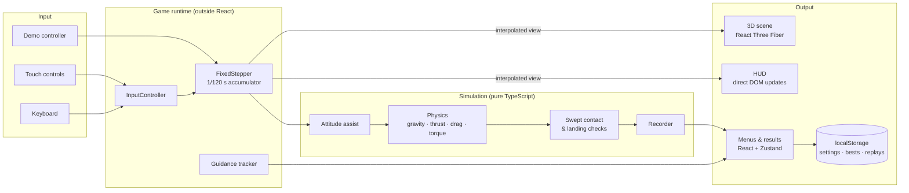
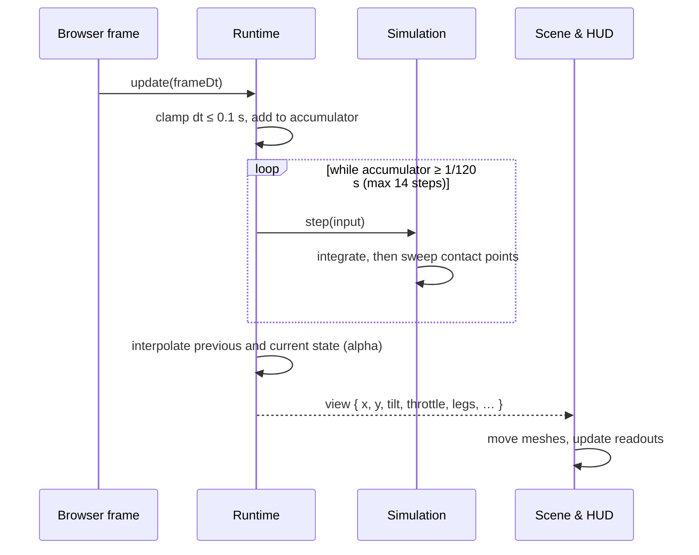
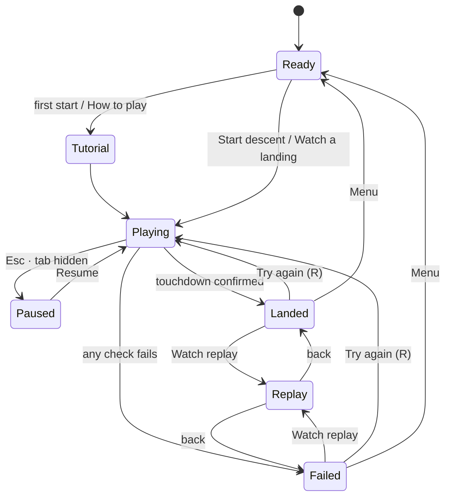

# Boostback — Rocket Landing Challenge

**Bring it home.** Land a fictional reusable booster on an ocean platform, then watch the replay to see why the landing worked or didn't.

Boostback is a browser game built on a simple, testable physics model. Every landing is judged on speed, tilt, leg state and position. Reaching the deck isn't enough.

> The booster, platform and all parameters are fictional and tuned for play. This is not flight software, and it is not affiliated with or endorsed by any launch company.

---

## Quick start

```bash
npm install
npm run dev          # http://localhost:5173
```

| Command | What it does |
| --- | --- |
| `npm run dev` | Start the dev server |
| `npm run build` | Type-check and build to `dist/` |
| `npm run preview` | Serve the production build |
| `npm test` | Simulation unit tests (Vitest) |
| `npx playwright install chromium` | One-time browser download for e2e tests |
| `npm run test:e2e` | Browser tests, desktop and mobile (Playwright) |

Requires Node 20+ and a browser with WebGL.

---

## How to play

| Action | Keyboard | Touch |
| --- | --- | --- |
| Throttle up / down | `W` `S` or `↑` `↓` (holds when released) | Drag the throttle slider |
| Lean left / right | `A` `D` or `←` `→` (returns upright when released) | Hold ◀ ▶ |
| Deploy landing legs | `L` (about 2.2 s to lock) | Legs button |
| Pause / resume | `Esc` | Pause button |
| Try again after a flight | `R` | Try again |

A landing succeeds only when **all** of these hold at first contact:

- a landing foot touches the deck first
- the legs are fully locked
- vertical speed, horizontal speed and tilt are within the preset's limits
- both feet are inside the dashed zone on the deck

**Good first run:** click **Watch a landing** to see the demo controller fly, then choose **Training** and press **Start descent**.

---

## Difficulty presets

| | Training | Standard | Challenge |
| --- | --- | --- | --- |
| Start height / descent rate | 380 m / 32 m/s | 520 m / 48 m/s | 640 m / 60 m/s |
| Offset from the deck | 60 m | 110 m | 150 m, drifting away |
| Propellant | 8,000 kg | 5,600 kg | 5,000 kg |
| Wind (steady ± gusts) | 1.5 ± 0.5 m/s | 4 ± 1.5 m/s | 7 ± 3 m/s |
| Touchdown limits (vertical / horizontal / tilt) | 4 m/s / 2.5 m/s / 8° | 3 m/s / 2 m/s / 6° | 2.5 m/s / 1.5 m/s / 5° |
| Usable deck (half-width) | ±32 m | ±24 m | ±17 m |
| Legs | Automatic | Manual | Manual |

The physics is identical across presets; only the scenario and rules change. Wind is seeded and deterministic, so nothing random happens mid-run. The tests show every preset can be landed with both the demo controller and keyboard-style on/off inputs.

---

## Architecture

The simulation is plain TypeScript with no React, Three.js or wall-clock time. React handles the menus. The 3D scene and HUD read the simulation inside their own animation callbacks, so nothing re-renders per frame.



### One frame



Fixed steps make a run independent of frame rate: a 30 fps run and a 144 fps run produce the same outcome, and that is tested. A long stall is clamped, so the simulation never advances several seconds at once.

### App states



---

## Simulation model

A planar rigid body in SI units, stepped at **1/120 s** with semi-implicit Euler.

- **Axes:** `+x` right, `+y` up, `y = 0` is the deck surface.
- **Tilt (θ):** measured from vertical, positive when the nose leans toward `+x`.
- **Forces:** gravity, engine thrust along the gimballed axis, and quadratic drag relative to the wind (split into components along and across the body).
- **Propellant:** mass flow is `thrust / (Isp · g₀)`. Mass falls as propellant burns, so the same throttle slows the booster more over time. Propellant never goes negative, and an empty tank produces no thrust.
- **Torque:** comes from the engine gimbal (±8°, rate-limited) and only works while the engine fires. Weak cold-gas thrusters near the top add a little more. Angular damping is an explicit, simplified term.
- **Attitude assist:** left/right sets a *target* lean (up to 15°). A cascaded controller (lean error → rotation rate → torque) drives the gimbal and thrusters. Releasing the key commands upright. **Direct gimbal** mode in Settings skips the assist.
- **Contact:** feet, nozzle and body corners are swept along their path every step, so even very fast impacts can't pass through the deck. The first contact decides the outcome; when several checks fail, one primary failure is reported and the rest appear in the analysis.

Fictional vehicle **BB-7** (body marked "BB-07"): 22 t dry mass, 620 kN maximum thrust, Isp 282 s, 36 m tall.

**Simplifications:** throttle runs continuously down to zero with instant relight; the centre of mass is fixed; motion is limited to one plane; there is no aerodynamic torque or grid-fin control, and the deck doesn't move. The **braking cue** is an estimate (full throttle, current tilt, no drag) and is hidden whenever those assumptions don't hold. This version models only the final descent, not the boostback burn the game is named after.

---

## Features

- **Replay** built from recorded state (never re-simulated): play/pause, scrubbing, 0.5×/1×/2× speed, event markers, side or chase camera, and optional overlays for flight path, velocity, thrust direction and target boundary.
- **Post-flight analysis** with altitude, vertical speed and throttle charts, a pass/fail table for each touchdown check, and observations drawn from the recorded flight.
- **Previous-attempt ghost**, shown only for the same preset, seed and steering mode, and hidden near touchdown.
- **Demo controller** that flies under the same physics, actuator limits and propellant as the player, and is clearly labelled.
- **Local persistence** (versioned, quota-aware): settings, best landing per preset, recent attempts, and the last 5 replays. Recordings can be exported and imported as JSON, and imports are validated.
- **Accessibility:** keyboard-operable menus, visible focus, reduced-motion support, status shown with text as well as colour, screen-reader announcements for guidance and results (never per-frame readouts), and pause at any time.
- **Graphics quality:** Low, Medium and High settings change pixel ratio, shadows, particles and wave detail. Physics is identical at every level. Browsers without WebGL get a clear message instead of a blank screen.

---

## Project structure

```
src/
├── sim/            Pure simulation (no React or Three.js)
│   ├── config.ts       Vehicle, limits and presets — tune here
│   ├── physics.ts      Forces and integration
│   ├── attitude.ts     Attitude assist controller
│   ├── contact.ts      Swept collision and landing evaluation
│   ├── simulation.ts   Simulation class, recorder, FixedStepper
│   ├── guidance.ts     Contextual messages and braking estimate
│   ├── replay.ts       Sampling, compaction, import validation
│   ├── analysis.ts     Post-flight observations
│   ├── demoController.ts
│   └── __tests__/
├── game/           Runtime loop, input, Zustand store, persistence, audio
├── scene/          Booster, platform, ocean/sky shaders, effects, camera
└── ui/             Start screen, HUD, touch controls, results, replay, dialogs
e2e/                Playwright browser tests
scripts/            Screenshot capture for visual QA
```

**Tuning:** all physics and difficulty parameters live in [`src/sim/config.ts`](src/sim/config.ts). After changing them, run `npm test`. The preset tests confirm each scenario can still be landed.

---

## Testing

**Unit tests:** 51 Vitest tests covering:

- gravity and how thrust acceleration depends on mass
- propellant consumption, which never goes negative and stops thrust when empty
- gimbal torque direction
- bit-identical determinism for the same seed and inputs
- frame-rate independence
- stall clamping
- every touchdown outcome
- that contact cannot tunnel through the deck
- that replays preserve the recorded result
- import validation
- guidance hysteresis
- that every preset can be landed by both the demo controller and a keyboard-style pilot

**Browser tests:** 8 Playwright tests covering:

- start and tutorial, then throttle and legs input
- pause freezing the simulation
- crash, then restart with `R`
- demo landing, analysis, and replay scrubbing and speed
- settings persistence
- the About dialog
- mobile touch controls
- no layout overflow or blocked primary buttons

`node scripts/screenshots.mjs <outDir>` captures key states for visual review (it needs the dev server running).

---

## Credits & references

All geometry, textures and audio are generated in code: no third-party models, images, fonts or sound files. Audio is synthesized with the Web Audio API.

Background reading (public sources, not used as model data):

- [SpaceX — Falcon 9 overview](https://www.spacex.com/vehicles/falcon-9/)
- [SpaceX — Mission (reusability)](https://www.spacex.com/mission/)
- [NASA Glenn — Forces on a rocket](https://www.grc.nasa.gov/www/k-12/rocket/rktfor.html)
- [NASA Glenn — Gimbaled thrust](https://www.grc.nasa.gov/www/k-12/rocket/gimbaled.html)
- [NASA Glenn — Rocket thrust summary](https://www.grc.nasa.gov/www/k-12/rocket/rktthsum.html)

Built with React, TypeScript, Vite, Three.js / React Three Fiber, Zustand, Tailwind CSS and Lucide.
